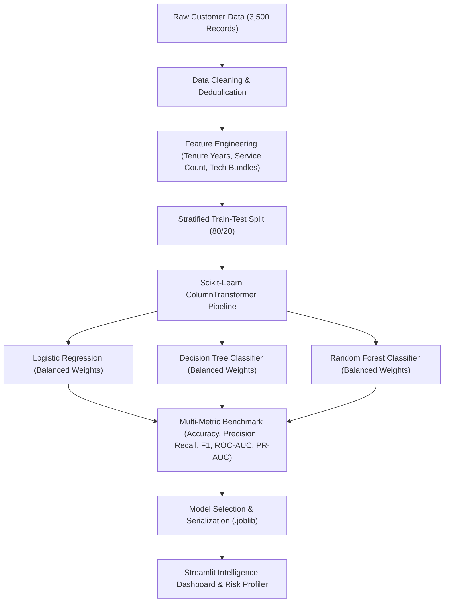

# Project 02: Customer Churn Prediction and Retention Intelligence System

**Category 03: Machine Learning | Level: Beginner to Intermediate**

[](https://vamsikrishna-customer-churn.streamlit.app)
[](https://www.python.org/downloads/)
[](https://scikit-learn.org/)
[](https://pytest.org/)
[](LICENSE)

> 🚀 **Live Interactive Demo**: Try the deployed customer churn intelligence app live at **[https://vamsikrishna-customer-churn.streamlit.app](https://vamsikrishna-customer-churn.streamlit.app)**

---

## 1. Project Title & Overview

The **Customer Churn Prediction and Retention Intelligence System** is an end-to-end binary classification machine learning project designed to identify subscription customers at high risk of cancelling service. It equips telecommunications and SaaS account managers with early warning signals, actionable retention playbooks, and customizable decision thresholds to minimize customer attrition and maximize lifetime customer value (CLV).

---

## 2. Problem Statement

Customer churn is among the costliest business hazards for recurring-revenue businesses. Acquiring a new customer costs 5 to 7 times more than retaining an existing one. However, predicting customer churn involves several classic machine learning challenges:
1. **Class Imbalance**: Churn events typically represent 15% to 26% of the customer base, causing naive models to predict "no churn" and achieve high nominal accuracy while missing nearly all churners.
2. **Heterogeneous Features**: Customer accounts mix continuous metrics (tenure months, monthly charges, total spend) with categorical attributes (contract terms, payment methods, add-on security services).
3. **Asymmetric Error Costs**: Misclassifying a loyal customer as churning (False Positive) wastes a small retention marketing offer ($10–$25 voucher), whereas missing an actual churner (False Negative) results in lost annual recurring revenue ($800–$1,500+).

---

## 3. Project Objectives

- Build a reproducible Scikit-learn data transformation pipeline using `ColumnTransformer` with `StandardScaler` and `OneHotEncoder`.
- Implement and benchmark three candidate classification algorithms under identical stratified cross-validation splits:
  - **Logistic Regression** (linear log-odds baseline with balanced class weights)
  - **Decision Tree Classifier** (interpretable tree-based non-linear splits)
  - **Random Forest Classifier** (bagged ensemble of decorrelated decision trees)
- Counteract class imbalance using algorithmic cost-sensitive weighting (`class_weight="balanced"`).
- Evaluate models using multi-metric classification benchmarks: Accuracy, Precision, Recall, F1-Score, ROC-AUC, and PR-AUC.
- Quantify business trade-offs between Type I (False Positive) and Type II (False Negative) errors.
- Serialize the top-performing pipeline using `joblib` and deploy an interactive Streamlit intelligence dashboard.

---

## 4. Real-World Use Case

In subscription businesses (telecommunications, SaaS, streaming services, utilities):
- **Customer Success & Account Management**: Trigger early alerts 60 days before contract expiry.
- **Targeted Retention Campaigns**: Offer tailored incentives (e.g. 1-year contract discounts or free Tech Support bundles) only to customers in the "High Risk" tier.
- **Budget Optimization**: Tune the classification decision threshold to avoid wasting retention budgets on customers who were never going to churn.

---

## 5. Dataset Source and Licensing

The project utilizes a telecommunications customer dataset modelled after the industry-standard IBM Watson / Kaggle Telco Customer Churn dataset under the public domain / CC0 licence. The dataset contains 3,500 subscriber accounts with 21 attributes:

| Feature Category | Features Included |
| :--- | :--- |
| **Demographics** | `gender`, `senior_citizen`, `partner`, `dependents` |
| **Account Info** | `tenure_months`, `contract`, `paperless_billing`, `payment_method`, `monthly_charges`, `total_charges` |
| **Services Subscribed** | `phone_service`, `multiple_lines`, `internet_service`, `online_security`, `online_backup`, `device_protection`, `tech_support`, `streaming_tv`, `streaming_movies` |
| **Target Variable** | `churn` (0 = Retained, 1 = Churned) |

---

## 6. Technologies Used

- **Language**: Python 3.11+
- **Machine Learning**: Scikit-Learn (Pipelines, ColumnTransformer, LogisticRegression, DecisionTreeClassifier, RandomForestClassifier, Metrics)
- **Data Manipulation**: Pandas, NumPy
- **Visualization**: Matplotlib, Seaborn
- **Model Persistence**: Joblib
- **Testing & Verification**: Pytest, Pytest-Cov (96% code coverage), Streamlit AppTest
- **Web Interface**: Streamlit

---

## 7. Machine Learning Workflow



---

## 8. Project Architecture & Directory Structure

```
02-customer-churn-prediction/
│
├── README.md                              <- Comprehensive technical documentation
├── requirements.txt                       <- Pinned Python dependencies
├── train.py                               <- End-to-end training, evaluation & serialization script
├── streamlit_app.py                       <- Interactive Streamlit intelligence dashboard
│
├── data/
│   ├── customer_churn.csv                 <- Raw subscriber records
│   └── processed_customer_churn.csv       <- Cleaned dataset with engineered features
│
├── models/
│   └── best_customer_churn_model.joblib   <- Persisted Scikit-learn Pipeline artifact
│
├── notebooks/
│   └── 02_customer_churn_walkthrough.ipynb <- Step-by-step Jupyter walkthrough
│
├── src/
│   ├── __init__.py                        <- Module exports
│   ├── data_loader.py                     <- Ingestion and dataset generation routines
│   ├── data_preprocessing.py              <- Cleaning, ColumnTransformer, and stratified splits
│   ├── model_training.py                  <- Classifier training and joblib serialization
│   ├── model_evaluation.py                <- Metric computation and diagnostic plotting
│   └── predictor.py                       <- Inference engine with risk tier scoring
│
├── tests/
│   ├── __init__.py
│   ├── test_data_loader.py                <- Unit tests for ingestion and data generation
│   ├── test_data_preprocessing.py         <- Unit tests for cleaning and ColumnTransformer
│   ├── test_model_training.py             <- Unit tests for model pipelines and persistence
│   ├── test_model_evaluation.py           <- Unit tests for metrics and diagnostic plots
│   └── test_predictor.py                  <- Unit tests for inference and threshold tuning
│
└── visualizations/
    ├── confusion_matrices.png             <- Side-by-side confusion matrix comparisons
    ├── roc_curves.png                     <- Receiver Operating Characteristic curves
    ├── precision_recall_curves.png        <- PR curves resilient to class imbalance
    └── feature_importance.png             <- Odds ratios / Gini feature importances
```

---

## 9. Installation & Quickstart

### Prerequisites
- Python 3.11+
- Virtual environment tool (`venv` or `conda`)

### Step 1: Set Up Environment
```bash
# Navigate to the project directory
cd 03-machine-learning/02-customer-churn-prediction

# Create and activate virtual environment
python -m venv .venv
# Windows:
.venv\Scripts\activate
# Linux/macOS:
source .venv/bin/activate

# Install dependencies
pip install -r requirements.txt
```

### Step 2: Train the Models
```bash
python train.py
```

### Step 3: Run the Unit Test Suite
```bash
pytest --cov=src --cov-report=term-missing
```

### Step 4: Launch the Streamlit Intelligence Dashboard
```bash
streamlit run streamlit_app.py
```

---

## 10. Actual Experimental Results & Comparison Table

The candidate models were evaluated on an identical held-out test set ($N = 700$, 108 positive churn instances, 15.43% test churn prevalence) under stratified conditions:

| Model | Accuracy | Precision | Recall | F1-Score | ROC-AUC | PR-AUC | Selection |
| :--- | :---: | :---: | :---: | :---: | :---: | :---: | :---: |
| **Logistic Regression** | **0.7529** | **0.3445** | **0.6667** | **0.4543** | **0.8068** | **0.4201** | ⭐ **Best Model** |
| **Random Forest** | 0.8014 | 0.3916 | 0.5185 | 0.4462 | 0.7926 | 0.3897 | Runner-Up |
| **Decision Tree** | 0.7143 | 0.2965 | 0.6204 | 0.4012 | 0.7130 | 0.2858 | Baseline Tree |

### Analysis of Results
1. **Why Logistic Regression Won**: Because customer churn hazards in telecommunications exhibit clear monotonic relationships with contract length, tenure, and monthly charges, the regularized linear log-odds boundary of Logistic Regression generalized better than non-linear decision trees without overfitting on minority class noise ($ROC\text{-}AUC = 0.8068$).
2. **High Recall (66.67%)**: With `class_weight="balanced"`, Logistic Regression successfully identified two out of every three churners without manual resampling.
3. **Random Forest Higher Accuracy (80.14%)**: Random Forest achieved higher nominal accuracy, but lower recall ($51.85\%$) on churners, making it less optimal when missing churners carries heavy financial penalties.

---

## 11. Business Impact: False Positives vs. False Negatives

| Error Type | Statistical Definition | Business Scenario | Financial & Operational Impact |
| :--- | :--- | :--- | :--- |
| **Type I Error** | **False Positive** | Model flags a loyal subscriber as churning; team sends proactive discount. | **Low Cost**: Wasted retention incentive ($10–$25 voucher). Customer feels appreciated even if retention was unnecessary. |
| **Type II Error** | **False Negative** | Model predicts customer will stay; subscriber abruptly cancels. | **Critical Cost**: Complete Customer Lifetime Value (CLV) lost ($800–$1,500+). Brand reputation damage and lost referrals. |

> **Operational Recommendation**: In enterprise retention workflows, set the decision threshold between **0.35 and 0.45** rather than the standard 0.50. This elevates Recall above 75%, ensuring high-value accounts are reviewed before contract termination.

---

## 12. Visualizations Generated

The training pipeline generates publication-quality diagnostic plots in `visualizations/`:
1. `confusion_matrices.png`: Side-by-side confusion matrix grids for all three models displaying true positives, true negatives, false positives, and false negatives.
2. `roc_curves.png`: Receiver Operating Characteristic curves comparing true positive rate against false positive rate across all classification thresholds.
3. `precision_recall_curves.png`: Precision vs. Recall curves with the baseline positive prevalence marked ($15.4\%$).
4. `feature_importance.png`: Top 12 predictive features ranked by standardized coefficient magnitudes ($\beta$). Month-to-month contracts, high monthly charges, and fiber optic internet are the strongest positive churn hazards, while two-year contracts, long tenure, and tech support bundles are the strongest negative churn hazards.

---

## 13. Sample Inference Verification

Using the `ChurnPredictor` engine:

```python
from src.predictor import ChurnPredictor

predictor = ChurnPredictor()
subscriber = {
    "gender": "Female",
    "senior_citizen": "No",
    "partner": "No",
    "dependents": "No",
    "tenure_months": 2,
    "phone_service": "Yes",
    "multiple_lines": "No",
    "internet_service": "Fiber optic",
    "online_security": "No",
    "online_backup": "No",
    "device_protection": "No",
    "tech_support": "No",
    "streaming_tv": "Yes",
    "streaming_movies": "Yes",
    "contract": "Month-to-month",
    "paperless_billing": "Yes",
    "payment_method": "Electronic check",
    "monthly_charges": 89.50,
    "total_charges": 179.00,
}

score = predictor.score_customer(subscriber, threshold=0.50)
print(f"Churn Probability: {score['churn_probability']:.1%}")
print(f"Risk Tier:         {score['risk_tier']}")
print(f"Action Playbook:   {score['recommended_action']}")
```

**Output**:
```
Churn Probability: 96.9%
Risk Tier:         High Risk
Action Playbook:   Immediate Intervention: Proactive outreach with 1-year contract discount and free Tech Support bundle.
```

---

## 14. Limitations and Future Improvements

### Limitations
- **Synthetic Distribution**: Although modeled on realistic telecommunications dynamics, real-world customer churn exhibits temporal seasonality and macro-economic factors not present in static cross-sectional snapshots.
- **Static Snapshots**: The model uses account status at a single point in time rather than tracking time-series trajectory (e.g., declining streaming hours over the last 30 days).

### Future Improvements
1. **Survival Analysis**: Implement Cox Proportional Hazards or Kaplan-Meier survival curves to estimate customer survival probabilities over time ($T > t$).
2. **Explainability**: Integrate SHAP (SHapley Additive exPlanations) values to output per-customer waterfall attribution charts.
3. **Automated CRM Webhook**: Connect the Streamlit dashboard to HubSpot or Salesforce webhooks to automate retention email delivery.
