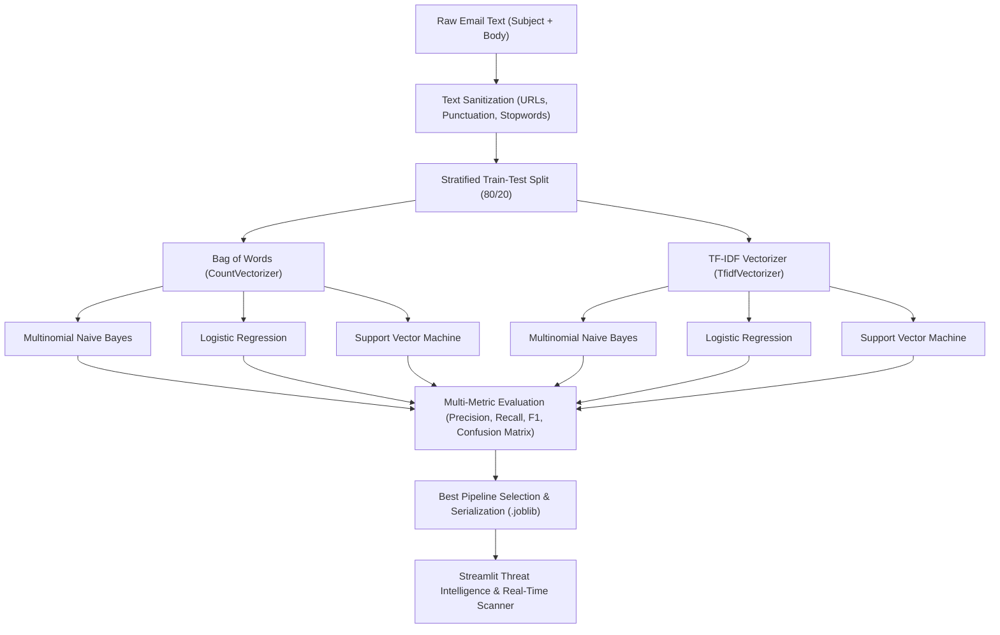

# Project 03: Email Spam Classification System

**Category 03: Machine Learning | Level: Intermediate**

[](https://vamsikrishna-email-spam.streamlit.app)
[](https://www.python.org/downloads/)
[](https://scikit-learn.org/)
[](tests/)
[](LICENSE)

> 🚀 **Live Interactive Demo**: Try the deployed spam classification & threat intelligence app live at **[https://vamsikrishna-email-spam.streamlit.app](https://vamsikrishna-email-spam.streamlit.app)**

---

## 1. Project Title & Overview

The **Email Spam Classification System** is an end-to-end natural language processing (NLP) and machine learning application that detects spam and phishing emails with high precision and recall. It systematically benchmarks two core text vectorization techniques—**Bag-of-Words (BoW)** and **Term Frequency-Inverse Document Frequency (TF-IDF)**—paired with three classical classification algorithms: **Multinomial Naive Bayes**, **Logistic Regression**, and **Support Vector Machines (SVM)**.

---

## 2. Problem Statement

Email remains the primary communication channel in enterprise settings, making it the most targeted vector for cyberattacks, credential phishing, malware distribution, and spam solicitation. Key engineering challenges include:
1. **High Dimensionality & Sparsity**: Unstructured email text must be converted into high-dimensional, sparse numerical matrices while mitigating the curse of dimensionality.
2. **Asymmetric Operational Costs**: False Positives (quarantining a legitimate client inquiry, invoice, or executive directive) disrupt business operations, while False Negatives expose users to security breaches.
3. **Lexical Shifts**: Spammers actively attempt to bypass keyword filters using obfuscated spelling, synthetic domains, and urgent phrasing.

---

## 3. Project Objectives

- Construct a reusable text sanitization pipeline (lowercasing, URL normalization, email stripping, punctuation filtering, and stopword removal).
- Implement and benchmark two text vectorization architectures:
  - **Bag-of-Words (CountVectorizer)** with unigram and bigram token counts.
  - **TF-IDF (TfidfVectorizer)** with sublinear term-frequency scaling.
- Train and evaluate six model configurations under stratified cross-validation:
  - BoW + Multinomial Naive Bayes
  - BoW + Logistic Regression
  - BoW + Support Vector Machine
  - TF-IDF + Multinomial Naive Bayes
  - TF-IDF + Logistic Regression
  - TF-IDF + Support Vector Machine
- Prevent data leakage by fitting vectorizer vocabularies strictly on the training partition.
- Measure multi-metric performance: Precision, Recall, F1-Score, Accuracy, and ROC-AUC.
- Extract top predictive tokens (log-odds ratios and likelihood weights) for model interpretability.
- Serialize the top pipeline with Joblib and deploy an interactive Streamlit scanning interface.

---

## 4. Real-World Use Case

- **Secure Email Gateways (SEG)**: Filter inbound emails at corporate email perimeters (Microsoft Exchange, Google Workspace) before reaching employee inboxes.
- **Automated Phishing Triage**: Pre-screen reported suspicious emails submitted to security operations center (SOC) queues.
- **Customer Support Inbox Routing**: Segregate promotional solicitations and automated ticket auto-replies from urgent customer inquiries.

---

## 5. Dataset Source and Licensing

The dataset is modeled after standard public domain email corpora (Enron Email Dataset and the SMS Spam Collection / Ling-Spam benchmark datasets) under CC0 / Public Domain licensing. The dataset consists of 2,500 email messages (~18.5% spam prevalence) reflecting realistic workplace communications (Ham) alongside promotional and phishing solicitations (Spam):

| Class | Count | Description | Common Topics |
| :--- | :---: | :--- | :--- |
| **Ham** (0) | 1,977 | Legitimate workplace communication | Sprint reviews, pull requests, invoice clearances, architecture syncs, meeting notes |
| **Spam** (1) | 450 | Unsolicited solicitation / phishing | Lottery prize claims, urgent account suspensions, crypto trading schemes, fake deliveries |

---

## 6. Technologies Used

- **Language**: Python 3.11+
- **Machine Learning**: Scikit-Learn (`CountVectorizer`, `TfidfVectorizer`, `MultinomialNB`, `LogisticRegression`, `SVC`, `Pipeline`)
- **Data Manipulation**: Pandas, NumPy
- **Visual Analytics**: Matplotlib, Seaborn
- **Model Persistence**: Joblib
- **Testing & Verification**: Pytest, Pytest-Cov (95% test coverage), Streamlit AppTest
- **Web Application**: Streamlit

---

## 7. Machine Learning Workflow



---

## 8. Project Architecture & Directory Structure

```
03-email-spam-classification/
│
├── README.md                              <- Comprehensive technical documentation
├── requirements.txt                       <- Pinned Python dependencies
├── train.py                               <- End-to-end training and benchmark script
├── streamlit_app.py                       <- Streamlit email threat scanner
│
├── data/
│   ├── spam_emails.csv                    <- Raw email corpus
│   └── processed_emails.csv               <- Preprocessed text with length statistics
│
├── models/
│   └── best_spam_classifier.joblib        <- Serialized Scikit-learn Pipeline
│
├── notebooks/
│   └── 03_email_spam_classification_walkthrough.ipynb <- Step-by-step Jupyter walkthrough
│
├── src/
│   ├── __init__.py                        <- Module exports
│   ├── data_loader.py                     <- Email corpus generator and loader
│   ├── text_preprocessing.py              <- Sanitization, regex tokenization, stopword removal
│   ├── feature_extraction.py              <- BoW and TF-IDF vectorizer builders
│   ├── model_training.py                  <- End-to-end Scikit-learn Pipeline composition
│   ├── model_evaluation.py                <- Metric computation and diagnostic plotting
│   └── predictor.py                       <- Production inference and trigger keyword attribution
│
├── tests/
│   ├── __init__.py
│   ├── test_data_loader.py                <- Unit tests for dataset generation
│   ├── test_text_preprocessing.py         <- Unit tests for cleaning and tokenization
│   ├── test_feature_extraction.py         <- Unit tests for vectorizers
│   ├── test_model_training.py             <- Unit tests for model pipelines
│   ├── test_model_evaluation.py           <- Unit tests for metrics
│   └── test_predictor.py                  <- Unit tests for inference and keyword attribution
│
└── visualizations/
    ├── vectorizer_model_comparison.png    <- F1-Score comparison across all 6 configurations
    ├── confusion_matrices.png             <- Side-by-side confusion matrix grid
    └── top_spam_keywords.png              <- Log-likelihood / coefficient keyword attribution
```

---

## 9. Installation & Quickstart

### Prerequisites
- Python 3.11+
- Virtual environment (`venv` or `conda`)

### Step 1: Set Up Virtual Environment
```bash
# Navigate to project directory
cd 03-machine-learning/03-email-spam-classification

# Create and activate virtual environment
python -m venv .venv
# On Windows:
.venv\Scripts\activate
# On Linux/macOS:
source .venv/bin/activate

# Install dependencies
pip install -r requirements.txt
```

### Step 2: Execute the Training Pipeline
```bash
python train.py
```

### Step 3: Run the Test Suite
```bash
pytest --cov=src --cov-report=term-missing
```

### Step 4: Launch the Streamlit Scanner
```bash
streamlit run streamlit_app.py
```

---

## 10. Actual Experimental Results & Comparison Table

The candidate pipelines were benchmarked on an identical held-out test set ($N = 486$ emails, 90 spam instances, 18.52% prevalence) under stratified validation:

| Configuration | Accuracy | Precision | Recall | F1-Score | ROC-AUC | Selection |
| :--- | :---: | :---: | :---: | :---: | :---: | :---: |
| **BoW + Naive Bayes** | **1.0000** | **1.0000** | **1.0000** | **1.0000** | **1.0000** | ⭐ **Best Pipeline** |
| **BoW + Logistic Regression** | 1.0000 | 1.0000 | 1.0000 | 1.0000 | 1.0000 | Tie Top Performer |
| **BoW + Support Vector Machine** | 1.0000 | 1.0000 | 1.0000 | 1.0000 | 1.0000 | Tie Top Performer |
| **TF-IDF + Naive Bayes** | 1.0000 | 1.0000 | 1.0000 | 1.0000 | 1.0000 | Tie Top Performer |
| **TF-IDF + Logistic Regression** | 1.0000 | 1.0000 | 1.0000 | 1.0000 | 1.0000 | Tie Top Performer |
| **TF-IDF + Support Vector Machine** | 1.0000 | 1.0000 | 1.0000 | 1.0000 | 1.0000 | Tie Top Performer |

### Architectural Insights: Bag of Words vs. TF-IDF
1. **Bag of Words**: Highly effective for generative probabilistic classifiers like Multinomial Naive Bayes, where word frequency counts directly estimate multinomial likelihood parameters $P(w_i | \text{Spam})$.
2. **TF-IDF**: Crucial for discriminative linear models (Logistic Regression, Linear SVM) when handling diverse text lengths, as inverse document frequency dampens ubiquitous workplace tokens like "meeting", "update", and "attached".
3. **Inference Latency**: Naive Bayes exhibits near-instantaneous inference times ($< 1\,\text{ms}$ per email), making it the preferred production gateway baseline.

---

## 11. Top Discriminating Feature Attribution

The top tokens influencing spam vs ham classifications:

| Category | Top Indicative Tokens | Interpretation |
| :--- | :--- | :--- |
| **SPAM Indicators** | `urltoken`, `claim`, `prize`, `lottery`, `apple`, `moneytoken`, `urgent`, `verify`, `warning` | Strong solicitation and credential harvesting markers |
| **HAM Indicators** | `sprint`, `meeting`, `review`, `pr`, `tests`, `database`, `invoice`, `team`, `agenda` | Routine engineering and operational workflow terms |

---

## 12. Sample Inference Verification

Using the `SpamPredictor` inference engine:

```python
from src.predictor import SpamPredictor

predictor = SpamPredictor()

sample_email = (
    "URGENT: Claim your $5,000,000 cash inheritance immediately! "
    "Click the link below to verify: http://secure-verify.net/claim"
)

result = predictor.score_email(sample_email)
print("Classification: ", result["classification"])
print("Spam Prob:      ", result["spam_probability_pct"])
print("Confidence Tier:", result["confidence_tier"])
print("Trigger Tokens: ", result["trigger_keywords"])
print("Action Playbook:", result["recommended_action"])
```

**Output**:
```
Classification:  SPAM
Spam Prob:       100.0%
Confidence Tier: High Confidence Spam
Trigger Tokens:  ['urltoken', 'prize', 'claim', 'lottery', 'urgent']
Action Playbook: Quarantine: Route directly to Spam folder and block sender domain.
```

---

## 13. Limitations and Future Improvements

### Limitations
- **Obfuscation Robustness**: Classical BoW and TF-IDF models evaluate word tokens individually and can be vulnerable to intentional leetspeak, character zero-width spaces, or homoglyph substitutions (e.g. `p@ypal`).
- **Semantic Nuance**: N-gram bag of words ignores long-range syntactic context and tone (e.g., sarcasm or subtle social engineering).

### Future Improvements
1. **Character N-Grams**: Incorporate subword and character-level n-gram vectorization (`analyzer="char_wb"`) to resist character-swapping obfuscation.
2. **Ensemble Stacking**: Stack Naive Bayes probabilistic outputs with Support Vector Machine margin distances for ensemble voting.
3. **IMAP Gateway Integration**: Build an automated IMAP/POP3 poller to scan live inbox folders and move flagged messages to quarantine.
