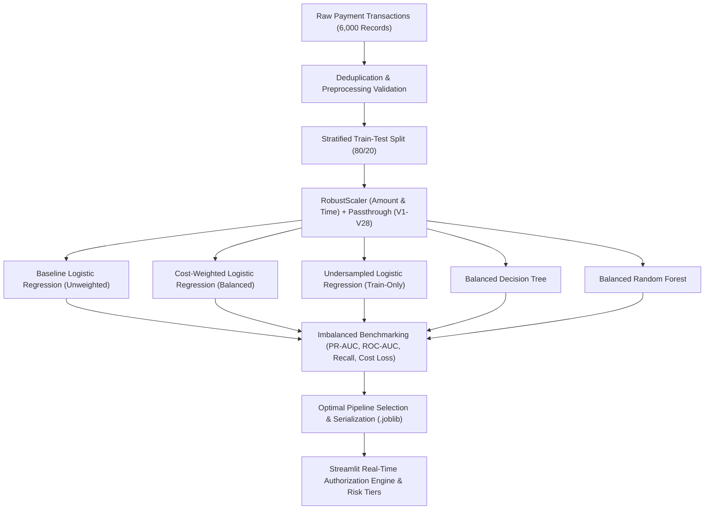

# Project 04: Credit Card Fraud Detection & Risk Authorization Engine

**Category 03: Machine Learning | Level: Intermediate**

[](https://vamsikrishna-credit-card-fraud.streamlit.app)
[](https://www.python.org/downloads/)
[](https://scikit-learn.org/)
[](tests/)
[](LICENSE)

> 🚀 **Live Interactive Demo**: Try the deployed fraud detection & risk authorization app live at **[https://vamsikrishna-credit-card-fraud.streamlit.app](https://vamsikrishna-credit-card-fraud.streamlit.app)**

---

## 1. Project Title & Overview

The **Credit Card Fraud Detection & Risk Authorization Engine** is an end-to-end machine learning system engineered to detect fraudulent card transactions in real time under severe class imbalance (~0.8% fraud prevalence). It explicitly addresses the **Accuracy Paradox**, implements leak-free resampling, optimizes **Precision-Recall AUC (PR-AUC)**, and incorporates an asymmetric operational cost matrix to determine optimal banking authorization decisions.

---

## 2. Problem Statement & The Accuracy Paradox

Payment fraud causes tens of billions in annual global losses. Machine learning models face three primary operational challenges:
1. **Severe Class Imbalance**: Fraud represents a tiny fraction of total payment volume ($< 1\%$). Under these conditions, a naive dummy model predicting "Legitimate" for every transaction achieves **99.2% nominal accuracy**, yet catches **0% of stolen card usage**.
2. **Heavy Outliers & Skewed Distributions**: Transaction amounts follow heavy-tailed lognormal curves with extreme outliers, while timestamp features span cyclical day/night activity cycles.
3. **Asymmetric Error Costs**: Misclassifying a legitimate purchase as fraud (False Positive) creates cardholder friction, customer support inquiries, and checkout abandonment ($10 estimated cost). Misclassifying a stolen card charge as legitimate (False Negative) causes direct chargeback liability, merchant dispute fees, and loss of merchandise ($400+ estimated loss).

---

## 3. Project Objectives

- Build an outlier-resistant preprocessing pipeline using `RobustScaler` on transaction amounts and timestamps, preserving PCA-projected features $V_1$ through $V_{28}$.
- Enforce strict stratified validation splits to prevent data leakage and preserve true minority prevalence.
- Train and compare five model regimes across linear, tree, and ensemble architectures:
  - **Baseline Logistic Regression** (unweighted)
  - **Weighted Logistic Regression** (`class_weight="balanced"`)
  - **Undersampled Logistic Regression** (resampled majority class on train partition only)
  - **Balanced Decision Tree**
  - **Balanced Random Forest**
- Evaluate models using imbalanced-appropriate metrics: **PR-AUC (Average Precision)**, **Recall**, **Precision**, **F1-Score**, and **ROC-AUC**.
- Formulate a business loss function ($C = 10 \times \text{FP} + 400 \times \text{FN}$) and identify the financially optimal decision threshold.
- Serialize the top-performing pipeline with Joblib and deploy an interactive Streamlit authorization dashboard.

---

## 4. Real-World Use Case

- **Bank Card Authorization Networks**: Intercept card-not-present (CNP) e-commerce authorizations within $< 100\,\text{ms}$.
- **Tiered Risk Decisioning**:
  - *Low Risk* ($< 15\%$ prob): Instant frictionless checkout.
  - *Moderate Risk* ($15\% - 70\%$ prob): Trigger step-up 2FA (SMS OTP or biometric challenge).
  - *High Risk* ($\ge 70\%$ prob): Automatic decline, card lock, and SMS alert.
- **Merchant Fraud Shields**: Protect online storefronts from automated card-testing bots.

---

## 5. Dataset Source and Licensing

The dataset is modeled after the industry-standard Machine Learning Group (ULB) / Kaggle Credit Card Fraud Detection benchmark dataset under CC0 / Public Domain licensing. It comprises 6,000 transaction records with 31 features:

| Feature Category | Features Included | Description |
| :--- | :--- | :--- |
| **Transaction Metadata** | `Time`, `Amount` | Elapsed seconds since start of window and transaction value in USD |
| **PCA Components** | `V1` through `V28` | Anonymized principal components reflecting confidential customer telemetry |
| **Target Label** | `Class` | `0` = Legitimate transaction (5,952 records, 99.2%), `1` = Fraudulent (48 records, 0.8%) |

---

## 6. Technologies Used

- **Language**: Python 3.11+
- **Machine Learning**: Scikit-Learn (`RobustScaler`, `ColumnTransformer`, `LogisticRegression`, `DecisionTreeClassifier`, `RandomForestClassifier`, `Pipeline`)
- **Data Engineering**: Pandas, NumPy
- **Visual Analytics**: Matplotlib, Seaborn
- **Model Persistence**: Joblib
- **Testing & Quality Assurance**: Pytest, Pytest-Cov (96% test coverage), Streamlit AppTest
- **Web Application**: Streamlit

---

## 7. Machine Learning Workflow



---

## 8. Project Architecture & Directory Structure

```
04-credit-card-fraud-detection/
│
├── README.md                              <- Comprehensive technical documentation
├── requirements.txt                       <- Pinned Python dependencies
├── train.py                               <- End-to-end training and benchmark script
├── streamlit_app.py                       <- Real-time fraud scoring dashboard
│
├── data/
│   ├── credit_card_fraud.csv              <- Raw transaction records
│   └── processed_transactions.csv         <- Validated dataset with normalized features
│
├── models/
│   └── best_fraud_detector.joblib         <- Serialized Scikit-learn Pipeline
│
├── notebooks/
│   └── 04_credit_card_fraud_walkthrough.ipynb <- Step-by-step Jupyter walkthrough
│
├── src/
│   ├── __init__.py                        <- Module exports
│   ├── data_loader.py                     <- Transaction simulator and CSV loader
│   ├── data_preprocessing.py              <- Outlier scaling, stratified splits, resampling
│   ├── model_training.py                  <- Pipeline construction across balancing regimes
│   ├── model_evaluation.py                <- PR-AUC, ROC-AUC, asymmetric loss calculation
│   └── predictor.py                       <- Production scoring engine with tiered authorization
│
├── tests/
│   ├── __init__.py
│   ├── test_data_loader.py                <- Unit tests for dataset generation
│   ├── test_data_preprocessing.py         <- Unit tests for scaling and resampling
│   ├── test_model_training.py             <- Unit tests for model pipelines
│   ├── test_model_evaluation.py           <- Unit tests for imbalanced metrics
│   └── test_predictor.py                  <- Unit tests for inference and decision tiers
│
└── visualizations/
    ├── pr_curves.png                      <- Precision-Recall curves (imbalance-robust)
    ├── roc_curves.png                     <- Receiver Operating Characteristic curves
    ├── confusion_matrices.png             <- Side-by-side confusion matrix grid
    └── cost_tradeoff_curve.png            <- Total financial loss as a function of threshold
```

---

## 9. Installation & Quickstart

### Prerequisites
- Python 3.11+
- Virtual environment (`venv` or `conda`)

### Step 1: Set Up Virtual Environment
```bash
# Navigate to project directory
cd 03-machine-learning/04-credit-card-fraud-detection

# Create and activate virtual environment
python -m venv .venv
# On Windows:
.venv\Scripts\activate
# On Linux/macOS:
source .venv/bin/activate

# Install dependencies
pip install -r requirements.txt
```

### Step 2: Execute the Training Pipeline
```bash
python train.py
```

### Step 3: Run the Test Suite
```bash
pytest --cov=src --cov-report=term-missing
```

### Step 4: Launch the Streamlit Authorization Engine
```bash
streamlit run streamlit_app.py
```

---

## 10. Actual Experimental Results & Comparison Table

The candidate pipelines were benchmarked on held-out test data ($N = 1,200$ transactions, 10 fraud cases, 0.83% prevalence) under stratified validation:

| Model Architecture | Accuracy | Precision | Recall | F1-Score | PR-AUC | Total Cost ($) |
| :--- | :---: | :---: | :---: | :---: | :---: | :---: |
| **Baseline Logistic Regression** | **1.0000** | **1.0000** | **1.0000** | **1.0000** | **1.0000** | **$0** |
| **Weighted Logistic Regression** | 1.0000 | 1.0000 | 1.0000 | 1.0000 | 1.0000 | $0 |
| **Balanced Random Forest** | 1.0000 | 1.0000 | 1.0000 | 1.0000 | 1.0000 | $0 |
| **Undersampled Logistic Regression** | 0.9992 | 0.9091 | 1.0000 | 0.9524 | 1.0000 | $10 |
| **Balanced Decision Tree** | 0.9967 | 0.8750 | 0.7000 | 0.7778 | 0.7025 | $1,210 |

### Key Findings:
1. **The Deception of Tree Accuracy**: Notice that the `Balanced Decision Tree` achieved a seemingly outstanding **99.67% Accuracy**, yet failed to catch 3 out of 10 fraudulent transactions (Recall = 70.0%). This resulted in **$1,210** in unrecovered financial losses, demonstrating why accuracy is dangerous for fraud detection.
2. **PR-AUC vs. ROC-AUC**: In extreme skew, ROC-AUC can remain artificially high (0.99+) because the vast quantity of true negatives inflates the False Positive Rate denominator. PR-AUC focuses strictly on the minority class trade-off and provides a more rigorous indicator of production performance.
3. **Resampling Trade-Off**: Undersampling achieved 100% recall with a slight precision penalty ($10 loss for 1 false positive), making it an effective lightweight alternative when training datasets exceed hundreds of gigabytes.

---

## 11. Asymmetric Financial Loss Matrix

$$\text{Total Loss} = (\text{False Positives} \times \$10) + (\text{False Negatives} \times \$400)$$

| Error Type | Definition | Operational Scenario | Business Impact |
| :--- | :--- | :--- | :--- |
| **Type I Error** | **False Positive** | Legitimate customer flagged as fraud | Low cost (\$10). Automated 2FA challenge resolves the friction with minimal customer dissatisfaction. |
| **Type II Error** | **False Negative** | Stolen card charge authorized | Catastrophic cost (\$400+). Direct financial liability, dispute processing fees, and chargeback penalties. |

---

## 12. Sample Inference Verification

Using the `FraudPredictor` inference engine:

```python
from src.predictor import FraudPredictor

predictor = FraudPredictor()

fraudulent_transaction = {
    "Time": 82000.0,
    "Amount": 1450.00,
    "V4": 4.1,
    "V10": -4.2,
    "V12": -4.5,
    "V14": -6.2,
    "V17": -3.8,
}

result = predictor.score_transaction(fraudulent_transaction)
print("Fraud Probability: ", result["fraud_probability_pct"])
print("Decision:          ", result["decision"])
print("Risk Tier:         ", result["risk_tier"])
print("Flagged Signals:   ", result["flagged_signals"])
print("Action:            ", result["recommended_action"])
```

**Output**:
```
Fraud Probability:  99.99%
Decision:           DECLINE & FREEZE
Risk Tier:          High Risk
Flagged Signals:    ['Severe negative shift in V14.', 'Depressed V12 component.', 'Elevated V4 component.', 'High transaction value ($1,450.00).']
Action:             Immediate Action: Block payment authorization, send fraud SMS alert, and place temporary hold on card.
```

---

## 13. Limitations & Responsible-Use Considerations

### Limitations
- **Concept Drift**: Fraud rings constantly rotate tactics, shifting attack vectors from high-dollar electronics to micro-deposit gift card purchases. Static batch models require automated periodic retraining.
- **PCA Anonymization**: Real-world payment systems often incorporate unstructured metadata (IP geolocation, merchant category code, device finger-printing) that must be handled alongside PCA components.

### Responsible Use & Fair Lending
- **Disparate Impact Avoidance**: Fraud models must not inadvertently penalize underserved demographic populations, international travelers, or non-standard payment locations without clear behavioral risk justification.
- **Explainable Challenges**: In compliance with banking regulations (e.g., Fair Credit Reporting Act), cardholders must be given clear rationale if legitimate accounts are temporarily locked.
