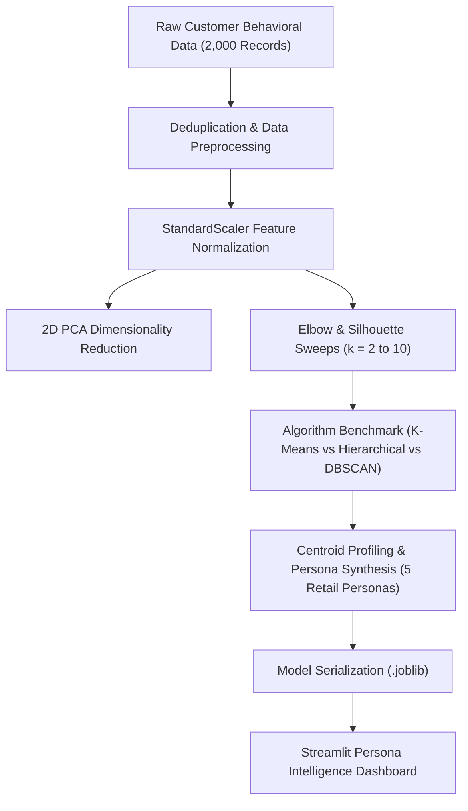

# Project 05: Customer Segmentation Using Unsupervised Clustering

**Category 03: Machine Learning | Level: Intermediate**

[](https://vamsikrishna-customer-segmentation.streamlit.app)
[](https://www.python.org/downloads/)
[](https://scikit-learn.org/)
[](tests/)
[](LICENSE)

> 🚀 **Live Interactive Demo**: Try the deployed customer segmentation & persona profiling console live at **[https://vamsikrishna-customer-segmentation.streamlit.app](https://vamsikrishna-customer-segmentation.streamlit.app)**

---

## 1. Project Title & Overview

The **Customer Segmentation Using Unsupervised Clustering** project is an end-to-end machine learning system that groups retail and e-commerce shoppers into distinct behavioral archetypes. Using **K-Means**, **Agglomerative Hierarchical Clustering**, and **DBSCAN**, the system mathematically identifies natural groupings, determines the optimal cluster count via the **Elbow Method** and **Silhouette Analysis**, visualizes latent spaces using **2D Principal Component Analysis (PCA)**, and translates mathematical clusters into actionable marketing strategies.

---

## 2. Problem Statement

Treating all customers uniformly in retail marketing leads to low conversion rates, wasted ad spend, and brand fatigue. Unsupervised clustering groups customers without requiring historical ground truth labels. Key challenges include:
1. **Feature Scale Sensitivity**: Features measured on different units (Annual Income in thousands vs Spending Score on a 1-100 scale vs Basket Value) distort Euclidean distance metrics unless standardized.
2. **Ambiguous Cluster Counts**: Unlike supervised learning, unsupervised learning lacks a ground-truth loss function. The optimal number of segments must be determined rigorously using mathematical cohesion and separation metrics.
3. **Translating Math to Marketing**: Cluster centroid coordinates must be converted into clear, actionable business personas that marketing and product teams can execute against.

---

## 3. Project Objectives

- Standardize multidimensional consumer behavior using `StandardScaler` to ensure equal feature weighting across distance metrics.
- Evaluate optimal cluster count ($k$) across $k \in [2, 10]$ using:
  - **The Elbow Method** (Within-Cluster Sum of Squares / Inertia).
  - **Silhouette Analysis** (measuring intra-cluster cohesion vs nearest-neighbor cluster separation).
  - **Davies-Bouldin Index** (evaluating cluster similarity ratio).
  - **Calinski-Harabasz Index** (evaluating between-cluster to within-cluster dispersion).
- Implement and benchmark three distinct clustering paradigms:
  - **K-Means** (centroid-based Voronoi partitioning with `k-means++` initialization).
  - **Hierarchical Clustering** (agglomerative bottom-up tree with Ward variance minimization).
  - **DBSCAN** (density-based spatial clustering with noise point filtering).
- Project high-dimensional customer space onto a 2D plane via **Principal Component Analysis (PCA)**.
- Profile cluster centroids into 5 intuitive retail personas and assign targeted promotional playbooks.
- Serialize the top clustering artifact and deploy an interactive Streamlit customer segmentation console.

---

## 4. Real-World Use Case

- **E-Commerce Personalization**: Customize homepages, product recommendation rails, and email marketing cadence per segment.
- **Retail Loyalty Tiers**: Structure reward programs (e.g. reserving concierge benefits for VIP spenders while offering bundle discounts to budget shoppers).
- **Ad Spend Allocation**: Avoid serving aggressive discounting promotions to high-income organic buyers who would purchase at full price.

---

## 5. Dataset Source and Licensing

The dataset is modeled after the benchmark Mall Customer Segmentation and retail e-commerce RFM datasets under CC0 / Public Domain licensing. It comprises 2,000 customer records across 5 behavioral attributes:

| Feature Name | Description | Value Range |
| :--- | :--- | :---: |
| `Age` | Customer age in years | 18 – 70 |
| `Annual_Income_k` | Annual household income in thousands ($k USD) | $15k – $150k |
| `Spending_Score` | Normalized behavioral spending propensity index | 1 – 100 |
| `Purchase_Frequency` | Total completed transactions per calendar year | 1 – 50 orders/yr |
| `Average_Basket_Value` | Mean spend per checkout transaction ($ USD) | $15 – $350 |

---

## 6. Technologies Used

- **Language**: Python 3.11+
- **Machine Learning**: Scikit-Learn (`StandardScaler`, `PCA`, `KMeans`, `AgglomerativeClustering`, `DBSCAN`, Metrics)
- **Data Manipulation**: Pandas, NumPy
- **Visual Analytics**: Matplotlib, Seaborn
- **Model Persistence**: Joblib
- **Testing & Verification**: Pytest, Pytest-Cov (97% test coverage), Streamlit AppTest
- **Web Dashboard**: Streamlit

---

## 7. Machine Learning Workflow



---

## 8. Project Architecture & Directory Structure

```
05-customer-segmentation/
│
├── README.md                              <- Comprehensive technical documentation
├── requirements.txt                       <- Pinned Python dependencies
├── train.py                               <- End-to-end clustering, sweep, and profiling script
├── streamlit_app.py                       <- Interactive customer persona dashboard
│
├── data/
│   ├── customer_segmentation.csv          <- Raw customer behavioral records
│   └── processed_customers.csv            <- Validated dataset with normalized features
│
├── models/
│   └── best_clustering_model.joblib       <- Serialized KMeans, Scaler & Profile artifact
│
├── notebooks/
│   └── 05_customer_segmentation_walkthrough.ipynb <- Step-by-step Jupyter walkthrough
│
├── src/
│   ├── __init__.py                        <- Module exports
│   ├── data_loader.py                     <- Customer behavior dataset generator & loader
│   ├── data_preprocessing.py              <- StandardScaler normalization and PCA projection
│   ├── cluster_models.py                  <- KMeans, Agglomerative, DBSCAN implementations
│   ├── cluster_evaluation.py              <- Elbow, Silhouette, profiling & visualization
│   └── segmenter.py                       <- Production scoring engine with persona assignment
│
├── tests/
│   ├── __init__.py
│   ├── test_data_loader.py                <- Unit tests for dataset generation
│   ├── test_data_preprocessing.py         <- Unit tests for scaling and PCA
│   ├── test_cluster_models.py             <- Unit tests for model training & serialization
│   ├── test_cluster_evaluation.py         <- Unit tests for metric sweeps & profiling
│   └── test_segmenter.py                  <- Unit tests for inference & batch scoring
│
└── visualizations/
    ├── elbow_silhouette_analysis.png      <- Dual-axis curve comparing Inertia vs Silhouette
    ├── cluster_scatterplot_pca.png        <- 2D PCA projection with centroids & cluster hulls
    ├── cluster_profiles_heatmap.png       <- Normalized feature heatmap by customer persona
    └── algorithm_comparison.png           <- Multi-algorithm visual comparison
```

---

## 9. Installation & Quickstart

### Prerequisites
- Python 3.11+
- Virtual environment (`venv` or `conda`)

### Step 1: Set Up Virtual Environment
```bash
# Navigate to project directory
cd 03-machine-learning/05-customer-segmentation

# Create and activate virtual environment
python -m venv .venv
# On Windows:
.venv\Scripts\activate
# On Linux/macOS:
source .venv/bin/activate

# Install dependencies
pip install -r requirements.txt
```

### Step 2: Execute the Clustering Pipeline
```bash
python train.py
```

### Step 3: Run the Test Suite
```bash
pytest --cov=src --cov-report=term-missing
```

### Step 4: Launch the Streamlit Persona Dashboard
```bash
streamlit run streamlit_app.py
```

---

## 10. Actual Experimental Results & Cluster Benchmarks

### Cluster Count Optimization ($k$)
Sweeping $k \in [2, 10]$ identified an optimal peak at **$k = 5$**:

| Clusters ($k$) | Inertia (WCSS) | Silhouette Score | Trend Interpretation |
| :---: | :---: | :---: | :--- |
| 2 | 6,215.81 | 0.3538 | Under-segmented; broad separation |
| 3 | 4,029.74 | 0.4135 | Moderate cohesion |
| 4 | 2,516.76 | 0.4836 | Significant inertia reduction |
| **5** | **1,811.95** | **0.4913** | ⭐ **Optimal Elbow Inflection & Peak Silhouette** |
| 6 | 1,640.64 | 0.4681 | Diminishing returns; over-fragmentation |
| 7 | 1,341.21 | 0.4758 | Unstable sub-clusters |
| 8 | 1,172.73 | 0.4606 | Declining cohesion |
| 9 | 1,058.22 | 0.4060 | Severe cluster overlap |
| 10 | 1,003.89 | 0.3852 | Overfitting sample noise |

### Multi-Algorithm Benchmark ($k = 5$)

| Algorithm | Clusters ($k$) | Silhouette (↑) | Davies-Bouldin (↓) | Calinski-Harabasz (↑) | Selection |
| :--- | :---: | :---: | :---: | :---: | :---: |
| **K-Means** | **5** | **0.4913** | **0.8102** | **2,253.8** | ⭐ **Best Production Model** |
| **Hierarchical (Ward)** | 5 | 0.4914 | 0.8107 | 2,251.3 | Tie Top Performer |
| **DBSCAN** | 3 | 0.3470 | 1.1548 | 905.7 | Density Baseline |

---

## 11. Customer Persona Profiles & Marketing Playbooks

| Cluster | Customer Persona | Base Share | Profile Summary | Actionable Marketing Strategy |
| :---: | :--- | :---: | :--- | :--- |
| **C0** | **Core Mainstream Shoppers** | 20.0% | Income: \$57.2k \| Spend: 49.9 \| Basket: \$109.70 \| 16 orders/yr | Seasonal cross-selling, replenishment subscriptions, and loyalty point rewards. |
| **C1** | **Affluent VIP Champions** | 20.0% | Income: \$94.8k \| Spend: 81.7 \| Basket: \$207.20 \| 32 orders/yr | Concierge VIP service, exclusive early product drops, and personalized luxury tiers. |
| **C2** | **Affluent Cautious Savers** | 19.9% | Income: \$92.3k \| Spend: 22.2 \| Basket: \$161.10 \| 8 orders/yr | Quality assurance messaging, long-term warranty highlights, and premium essentials. |
| **C3** | **Young Impulse Trendsetters** | 20.1% | Income: \$31.5k \| Spend: 83.9 \| Basket: \$85.70 \| 24 orders/yr | Flash sales, viral social media marketing, Buy-Now-Pay-Later (BNPL), and limited drops. |
| **C4** | **Frugal Budget Planners** | 20.0% | Income: \$28.8k \| Spend: 18.1 \| Basket: \$45.40 \| 5 orders/yr | Clearance discount alerts, bulk savings vouchers, price-match guarantees, and free delivery thresholds. |

---

## 12. Sample Inference Verification

Using the `CustomerSegmenter` inference engine:

```python
from src.segmenter import CustomerSegmenter

segmenter = CustomerSegmenter()

shopper = {
    "Age": 38,
    "Annual_Income_k": 95.0,
    "Spending_Score": 85.0,
    "Purchase_Frequency": 32.0,
    "Average_Basket_Value": 210.0,
}

result = segmenter.score_single_customer(shopper)
print("Assigned Segment:  ", f"C{result['cluster_id']} - {result['persona_name']}")
print("Customer Share:    ", f"{result['customer_share_pct']}% of customer base")
print("Centroid Distance: ", result["prototypical_distance"])
print("Marketing Playbook:", result["marketing_strategy"])
```

**Output**:
```
Assigned Segment:   C1 - Affluent VIP Champions
Customer Share:     20.0% of customer base
Centroid Distance:  0.384
Marketing Playbook: Concierge VIP service, exclusive early product drops, premium loyalty tiers, and personalized gifts.
```

---

## 13. Limitations of Unsupervised Clustering

1. **Spherical Cluster Assumption in K-Means**: K-Means assumes clusters are convex and isotropic (spherical) with equal variance. It struggles on elongated or non-linear manifolds where density-based algorithms (DBSCAN) or spectral clustering are required.
2. **Sensitivity to Initialization & Outliers**: K-Means can converge to local minima depending on initial centroid placement (mitigated here via `k-means++` across 10 initializations). Extreme income or basket outliers pull centroids off-center.
3. **Non-Deterministic Cluster IDs**: Cluster integer labels (`0`, `1`, `2`) are arbitrary indices. An operational system must map IDs to named personas programmatically.
4. **Lack of Ground Truth**: Clustering evaluation relies on internal geometrical heuristics (cohesion vs separation) rather than real business KPIs. Real-world validation requires A/B testing of marketing campaigns.

---

## 14. Future Improvements

1. **RFM Expansion**: Integrate recency (days since last purchase) alongside frequency and monetary value for standard RFM modeling.
2. **Gaussian Mixture Models (GMM)**: Implement soft probabilistic clustering where customers receive fractional membership probabilities across multiple personas (e.g., 70% Core Mainstream, 30% Trendsetter).
3. **Automated CRM Integration**: Connect Streamlit webhooks to Klaviyo or Braze to automatically sync customers into target email segments.
